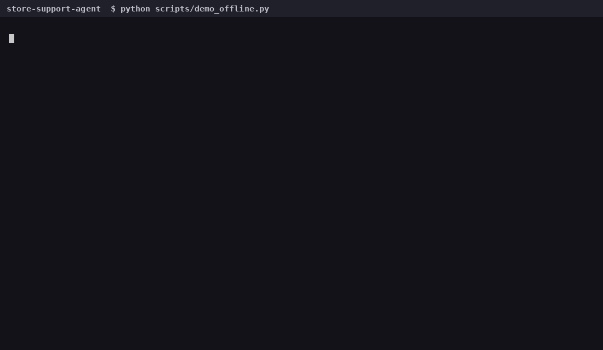
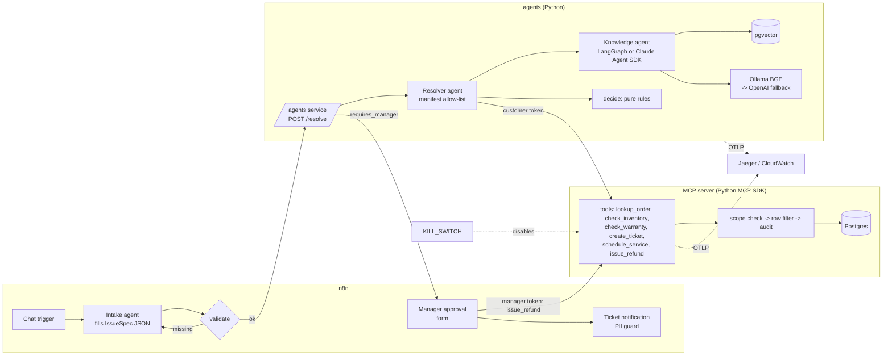

# Store Support Agent

A governed multi-agent customer-issue resolver. A customer describes a problem, an intake agent
turns it into a fixed-schema spec, a knowledge agent answers from store policy with citations, a
resolver proposes an action through scoped MCP tools, and a human manager approves anything that
moves money. Every step is traced, every tool call is access-checked and audited, and a kill
switch stops all tool execution at once.



**Governance, in one line each**

| Concern | Where it lives | Enforced by |
|---|---|---|
| Entitlement (may this scope call this tool?) | `access/rules.py` `authorize_tool` | MCP server, every call |
| Data authorization (may this user see this row?) | `access/rules.py` `row_filter` -> SQL `WHERE` | Repository, every query |
| Tenant isolation | `tenant_id` is mandatory on every read/write; checked first | Repository + vector store |
| Agent identity vs user identity | `RequestContext(principal, agent)` logged in separate fields | Audit log, spans |
| No PII in logs/traces | Presidio + regex redaction as the *first* structlog processor | `governance/redaction.py` |
| Agent allow-list | `agents/<name>/manifest.yaml` `tools:` | `ResolverAgent.call_tool` |
| Kill switch | `KILL_SWITCH=true` or `touch /tmp/ssa.KILL` | MCP server + SDK `PreToolUse` hook |
| Money needs a human | Resolver *proposes*; only a `manager:refund` token can `issue_refund` | Scope check + n8n approval |
| Answers only from context | Grader + citation validator; otherwise escalate | `knowledge/pipeline.py` |

## Architecture



Two identities travel with every request: the **user** (scoped token: `customer:read_own`,
`staff:read_all`, `manager:refund`) and the **agent** (`X-Agent-Name/Version`, from its
manifest). The server re-derives the principal from the token, so an agent can never upgrade its
own scopes; the audit row and the trace carry both.

## Quick start

```bash
conda create -n ssa python=3.12 -y && conda activate ssa   # or: python3.12 -m venv .venv && source .venv/bin/activate
make install                # pip install -e ".[dev]"; add ".[pii]" + `python -m spacy download en_core_web_lg` for Presidio
make test                   # 140 unit + integration tests, no services needed (Postgres tests skip)
make eval                   # offline eval -> scorecard (zero network)
python scripts/demo_offline.py   # the whole demo flow in-process

cp .env.example .env        # add ANTHROPIC_API_KEY (and OPENAI_API_KEY for embedding fallback)
make up                     # postgres+pgvector (host port 5433), ollama (pulls bge-m3), n8n, jaeger, mcp, agents
make tokens >> .env         # demo tokens for n8n; then `docker compose up -d n8n` again
make demo                   # scripts/demo.sh against the live stack; `make reset-demo` to run it again
```

Docker Desktop needs **at least 6 GB** of memory for the full stack (Ollama's BGE-M3 alone is ~1.1 GB;
Settings -> Resources -> Memory). Containers use the small spaCy model for Presidio; set
`SPACY_MODEL=en_core_web_lg` for higher-recall NER where memory allows.

Then open n8n at `http://localhost:5678` and import `n8n/workflows/*.json` (see `n8n/README.md`),
Jaeger at `http://localhost:16686`.

## Demo flow

1. Customer: *"my steering wheel cover arrived damaged, order 1042"* -> n8n intake agent fills the
   `IssueSpec`; `/intake/validate` lists missing fields and n8n re-asks.
2. `/resolve` under the **customer** token: knowledge agent retrieves, grades, answers with
   `[manual-steering-wheel-cover.md#Common issues]`; resolver calls `lookup_order` and
   `check_warranty`; pure rules propose a full refund (`requires_manager=true`); `create_ticket`.
3. Manager approves in n8n; n8n calls MCP `issue_refund` with the **manager's** token.
4. Show the trace (one trace, spans per step and tool), the access log (agent and user separate,
   subject pseudonymized), `make eval` scorecard, then flip the kill switch and watch every call
   return `forbidden: kill_switch`.

## Repository map

```
src/store_support/
  access/        rules.py (pure entitlement/data-auth), identity.py, tokens.py (HMAC scoped tokens)
  mcp_server/    server.py (MCP SDK, streamable HTTP), tools.py (registry + single execution path),
                 repo_postgres.py / repo_memory.py, audit.py
  knowledge/     pipeline.py (steps), langgraph_agent.py, sdk_agent.py, COMPARISON.md,
                 embeddings.py (Ollama -> OpenAI fallback), store.py (pgvector), chunking.py, ingest.py
  resolver/      rules.py (pure decisions), agent.py, service.py (HTTP for n8n), mcp_client.py
  intake/        schema.py (IssueSpec JSON schema + validation)
  governance/    manifest.py, kill_switch.py, redaction.py (Presidio), logging_setup.py
  telemetry/     tracing.py (OTel: request > step.* > tool.*)
  evals/         datasets/ (30 questions, 20 scenarios), metrics.py, runner.py, drift.py
  data/          seed.py (Faker: 2 tenants, 200 customers, 50 SKUs, 500 orders)
agents/*/manifest.yaml     name, version, model, owner, tools, memory, limits
data/policies/*.md         13 policy and product-manual docs for the vector store
n8n/workflows/*.json       intake chat, manager approval, ticket notification
infra/terraform/           ECS Fargate x2 + RDS Postgres + ADOT sidecar (free-tier sized)
.github/workflows/         ci (lint, tests, evals, build), deploy (tag -> ECR + terraform), weekly drift
```

## Evals

`make eval` runs 30 labelled questions and 20 scripted scenarios and prints:

```
metric                     score   target
retrieval_hit_rate         0.967   >= 0.80  ok
faithfulness               0.867   >= 0.80  ok
tool_choice_accuracy       1.000   >= 1.00  ok
scope_enforcement          1.000   >= 1.00  ok
```

Offline mode (default, used in CI) swaps in a hashing embedder and an extractive answerer so the
numbers measure the pipeline deterministically. `--online` uses pgvector + Anthropic for the two
retrieval/generation metrics. The two governance metrics must be 1.0 or the job fails.
`weekly-eval.yml` reruns and `evals/drift.py` fails on a > 0.05 drop against the stored baseline.

### Judged tier: DeepEval

The scorecard is deterministic by design. A second, opt-in tier uses [DeepEval](https://github.com/confident-ai/deepeval)
with **Claude as the judge** on the same 30 questions and 20 scenarios:

| Metric | What it judges | Threshold |
|---|---|---|
| `FaithfulnessMetric` | every claim in the answer is supported by the retrieved chunks | 0.8 |
| `AnswerRelevancyMetric` | the answer addresses the question | 0.7 |
| `ContextualRelevancyMetric` | the retrieved chunks are on-topic | 0.5 |
| `ToolCorrectnessMetric` | resolver called exactly the expected tools, in order | 1.0 |

```bash
pip install -e ".[deepeval]"
make eval-deepeval                      # offline pipeline, judged (needs ANTHROPIC_API_KEY)
DEEPEVAL_MODE=online make eval-deepeval # live pgvector + Claude answers, judged (stack must be up)
```

`src/store_support/evals/deepeval_suite.py` converts results into `LLMTestCase`s; `tests/evals/`
holds the parametrized `assert_test` calls. The weekly workflow runs it when a key is configured.

## Reuse patterns

### Add an MCP tool in ~20 lines

```python
# 1. access/rules.py - declare the scope (the ONLY place scopes are mapped)
TOOL_SCOPES["cancel_order"] = Scope.STAFF_READ_ALL

# 2. mcp_server/tools.py - input model + handler + registry line
class CancelOrderIn(BaseModel):
    order_id: int = Field(ge=1)
    reason: str = Field(min_length=1, max_length=200)

def cancel_order(ctx: RequestContext, repo: Repository, a: CancelOrderIn) -> dict[str, Any]:
    o = _order_or_404(repo, ctx, a.order_id)          # row filter applied here
    if o.status != "placed":
        raise ToolError("business_rule", "only placed orders can be cancelled")
    return {"order_id": o.order_id, "status": repo.cancel(order=o, reason=a.reason)}

TOOLS["cancel_order"] = ToolSpec("cancel_order", "Cancel a placed order.", CancelOrderIn, cancel_order)

# 3. tests/unit/test_mcp_tools.py - write the denied/allowed/not_found cases first
```

The JSON schema, the scope check, the audit row, the span, and the kill switch come for free.

### Add a scope

```python
class Scope(StrEnum):
    ...
    SUPPORT_TRIAGE = "support:triage"

_SATISFIES[Scope.SUPPORT_TRIAGE] = frozenset({Scope.SUPPORT_TRIAGE, Scope.STAFF_READ_ALL})
```

Add a row to `test_access_rules.py` for what the scope must and must not satisfy. Tokens that
carry an unknown scope are rejected by `issue_token`/`parse_token`, so nothing else changes.

### Add an agent manifest

```yaml
# agents/triage-agent/manifest.yaml
name: triage-agent
version: 1.0.0
owner: support-platform@store.example
model: claude-sonnet-4-5
tools: [lookup_order, create_ticket]     # must exist in TOOL_SCOPES or the manifest fails to load
memory: { kind: session, ttl_minutes: 30 }
```

`load_all()` validates it, `/manifests` serves it, and `ResolverAgent.call_tool` refuses any tool
not in the list.

## LangGraph vs Claude Agent SDK

The knowledge agent is built twice over the same step functions. Short version: LangGraph puts
control flow in code (auditable, deterministic, easy to unit-test); the Agent SDK lets the model
drive while code still enforces the budget, the tenant, the citation check and the kill switch.
Details and the trade-offs in [`src/store_support/knowledge/COMPARISON.md`](src/store_support/knowledge/COMPARISON.md).

## AWS

`infra/terraform` deploys the same image as two Fargate services plus RDS Postgres (db.t3.micro)
with an ADOT sidecar exporting traces to X-Ray and logs to CloudWatch. Ollama is not deployed;
`FallbackEmbedder` moves to OpenAI automatically. `git tag v0.1.0 && git push --tags` runs
`deploy.yml`. See `infra/terraform/README.md`.

## Independent review

A separate reviewer audited tenant isolation, scope bypass, PII leakage and the kill switch after
the build. Two real bugs were found and fixed with tests (`tests/unit/test_hardening.py`,
`tests/integration/test_repo_postgres.py`): the Postgres refund was never committed on pooled
connections, and two concurrent approvals could both refund (now an atomic conditional `UPDATE`).
The one accepted limitation is documented in `n8n/README.md` (demo customer token).

## Development rules used here

- TDD: every module above has its tests written first (`tests/unit`, `tests/integration`).
- Pure functions for anything that decides (access rules, resolution rules, metrics).
- `tenant_id` is a required argument, never a default.
- PII columns (`full_name`, `email`, `phone`) are never selected by tool handlers.
- Python 3.11+, `ruff`, `mypy --strict` config in `pyproject.toml`.
